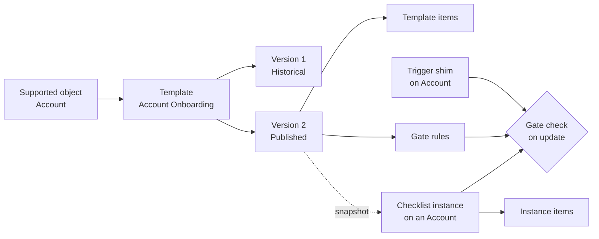

CheckR is a checklist framework for Salesforce records. Admins define
checklists declaratively; users complete them on the record page; and, where an
admin asks for it, Apex blocks a protected field change until the checklist is
complete.

## Concepts

| Term                   | What it is                                                                                                                                          |
| ---------------------- | --------------------------------------------------------------------------------------------------------------------------------------------------- |
| **Supported object**   | A `CKR_SupportedObject__mdt` record that registers a parent object, such as `Account`, with CheckR.                                                 |
| **Template**           | The long-lived identity of a checklist for one supported object, for example "Account Onboarding".                                                  |
| **Template version**   | A Draft, Published, or Historical snapshot of a template. Only one version per template is Published. Published and Historical versions are frozen. |
| **Template item**      | One checkbox step on a version, optionally required and optionally needing an explanation.                                                          |
| **Gate rule**          | A rule on a version that names a field on the parent object. A matching change is blocked while the governing checklist is incomplete.              |
| **Checklist instance** | A checklist attached to one record. It snapshots the version it was created from, and its items are copies of that version's items.                 |
| **Trigger shim**       | A three-line before-save trigger per gated object. Without it, gate rules on that object do nothing.                                                |
| **Bypass**             | An audited exception that lets a blocked save through, for data loads and integrations.                                                             |

## How they fit together

## The rules that matter most

- **Templates are versioned and immutable once published.** To change a
  published checklist or its gate rules, create a new Draft version and
  publish it. See [Publishing and new versions](06-publishing-and-new-versions.md).
- **An instance keeps its version.** A record with a checklist is judged by its
  own instance's version. A record without one is judged by the Published
  version.
- **Only updates are gated.** Inserting a record never runs a gate. See
  [Gate rules](05-gate-rules.md#what-is-not-gated).
- **Enforcement needs a trigger shim.** An admin can configure everything
  declaratively, but nothing is enforced on an object until a developer
  deploys its shim. See [Enabling an object](03-enabling-an-object.md).
- **Bypass is off by default and always audited.** See
  [Bypass](08-bypass.md).
- **History is append-only.** See [Audit history](09-audit-history.md).

For the full field list, see the [object model](../object-model.md).
