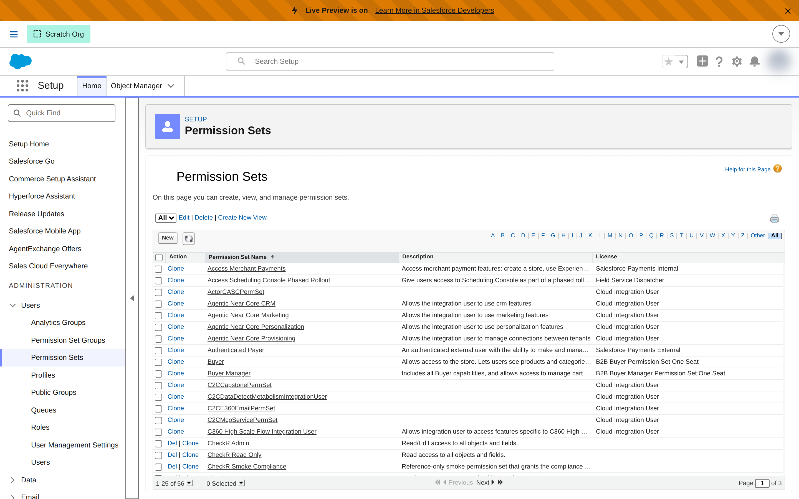

## Install

Install the `checkr` package version from its install link or with the CLI,
choosing **Install for Admins Only**. [Installation](../installation.md#install)
has the link, the command, and the prerequisites. Then, before anything else:

1. **Remove bypass and audit maintenance from the System Administrator
   profile.** Installing for admins grants that profile every custom permission
   in the package, so until you remove them every System Administrator's
   blocked saves go through (each recorded as a bypass event) and every System
   Administrator can edit audit history. See
   [Installation](../installation.md#remove-the-admin-profiles-bypass-and-audit-maintenance).
2. **Assign `CKR_Admin` to yourself** (see the table below).
3. **Enable an object.** The package ships the Account supported-object record
   but no trigger, so nothing is gated until a developer deploys a shim (see
   [Enabling an object](03-enabling-an-object.md)).

After installing, open the app from the App Launcher. Its label is **CheckR**. It has
**Checklist Templates** and **Checklist Instances** tabs. Audit and bypass
history have no tab; review it with reports (see chapter 9).

## Permission sets

| Permission set         | Assign to                                          | Grants                                                                                                                         |
| ---------------------- | -------------------------------------------------- | ------------------------------------------------------------------------------------------------------------------------------ |
| `CKR_Admin`            | Implementers and template managers                 | Template, version, item, and gate rule administration; Publish Version; read-only audit and bypass history.                    |
| `CKR_User`             | People who work checklists on records              | Create checklist instances, complete items, and use the checklist components.                                                  |
| `CKR_ReadOnly`         | People who only look                               | Read access to CheckR objects except bypass events. No Apex class access, so it cannot load the record-page viewer on its own. |
| `CKR_GateBypass`       | Data-load operators and integration users, briefly | Audited gate bypass. Never assign it with the others by default; see [Bypass](08-bypass.md).                                   |
| `CKR_AuditMaintenance` | A trusted operator, temporarily                    | Edit and delete on audit and bypass history. Export first; see [Audit history](09-audit-history.md).                           |

`CKR_Admin` does not include bypass, and after the post-install step above no
profile does either. It also does not grant the checklist components' Apex
classes, so add `CKR_User` to anyone who works checklists but is not a System
Administrator. No CheckR permission set grants the Salesforce **Run Reports**
permission or access to CheckR Settings. Users still need ordinary access to the
parent object (for example Account read or edit) for the checklist to appear
and for gated saves to happen at all.

The [security reference](../security.md#permission-sets) has the generated
object and field access table, the org-wide defaults, and who may hold bypass
privileges.

## Place the components

On each supported object's Lightning record page, add:

- the `ckrChecklistViewer` component, which lists the record's checklists in an
  accordion; and
- the **New Checklist** quick action (`ckrChecklistCreateAction`), which
  attaches a checklist from a Published template.

The CheckR app ships an Account record page with both. See
[Working a checklist](07-working-a-checklist.md) for what users see.
