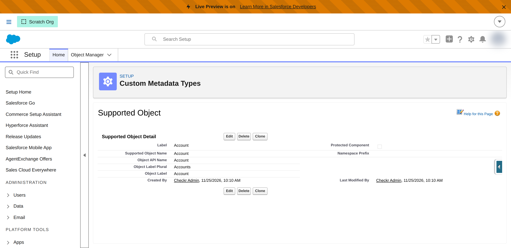

An object needs two things before CheckR gates it: a supported-object record,
which an admin creates, and a trigger shim, which a developer deploys. Without
the shim you can still attach and work checklists, but no save is blocked.

## 1. The supported-object record

Open **Setup → Custom Metadata Types → Supported Object → Manage Records**, and
create a record for the object. CheckR ships an `Account` record.



| Field                 | Set it to                                                                           |
| --------------------- | ----------------------------------------------------------------------------------- |
| Object API Name       | The object's API name, for example `Opportunity`. Must be unique.                   |
| Object Label / Plural | Descriptive labels for the object. CheckR does not display them yet.                |
| Description           | Why the object is supported.                                                        |
| Active                | Checked. Inactive objects are not gated, and the create action offers no templates. |
| Supports Gates        | Checked if gate rules should apply to this object.                                  |
| Handler Class Name    | Optional; leave blank unless a developer asks for it.                               |

Templates are matched to this record by object API name: a template's **Target
Object API Name** must equal this record's **Object API Name**. The template's
**Supported Object** field is a reference only; CheckR does not read it, but by
convention set it to this record's developer name (for the shipped record,
`Account`).

## 2. The trigger shim

A developer adds one before-save trigger per gated object and deploys it with
test coverage. For Opportunity (do not use the `CKR_` prefix for your own
triggers; see [packaging](../packaging.md#no-namespace)):

```apex
trigger OpportunityChecklistTrigger on Opportunity(before insert, before update) {
  CKR_ChecklistTriggerGateway.handleBefore(
    'Opportunity',
    Trigger.oldMap,
    Trigger.newMap
  );
}
```

The reference Account shim is `sfdx-source/reference/main/triggers/CKR_AccountTrigger.trigger`.
The shim holds no logic: it hands the changed records to CheckR, which loads
the active rules for the object and blocks matching saves. See
[platform constraints](../platform-constraints.md#trigger-shim-per-object) for
the cost per transaction and coverage requirements.

## Check that it worked

1. Create and publish a template for the object with one gate rule (chapters 4
   to 6).
2. On a record with no checklist, change the rule's field. The save should fail
   with the rule's error message.
3. If the save goes through, see
   [Troubleshooting](11-troubleshooting.md#a-gate-never-fires).
