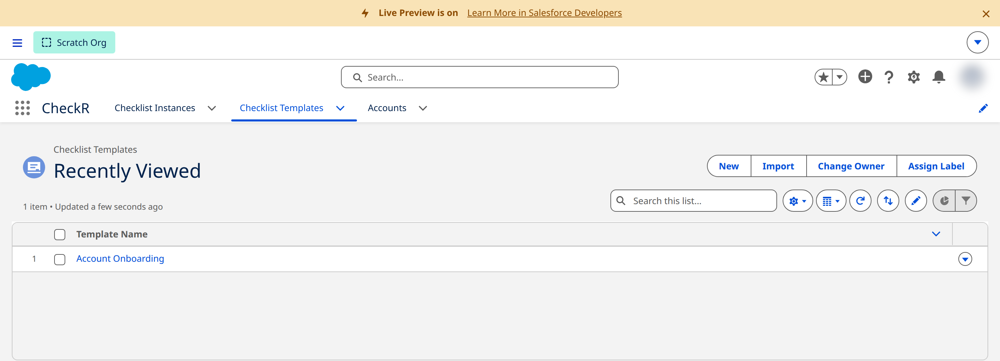
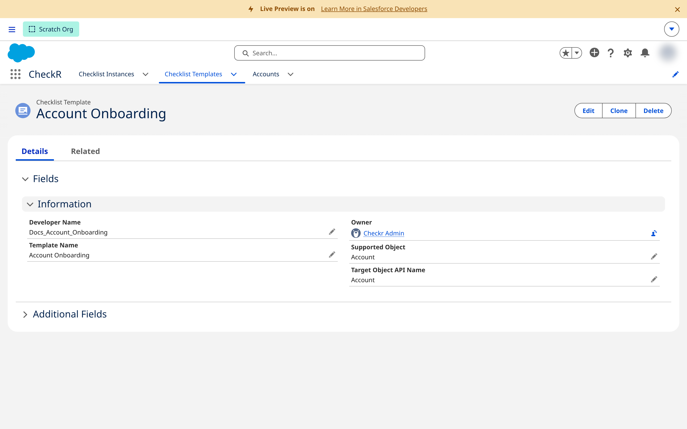

You need `CKR_Admin`. Work in the **CheckR** app.

## 1. Create the template

On **Checklist Templates**, select **New**.

| Field                  | Set it to                                                                                                                          |
| ---------------------- | ---------------------------------------------------------------------------------------------------------------------------------- |
| Template Name          | The name users see, for example "Account Onboarding".                                                                              |
| Developer Name         | A stable unique name, for example `Account_Onboarding`.                                                                            |
| Supported Object       | The supported-object record's developer name, for example `Account`.                                                               |
| Target Object API Name | The parent object API name, for example `Account`.                                                                                 |
| Active                 | Checked. Unchecking hides it from **New Checklist**; see [Retire a template](06-publishing-and-new-versions.md#retire-a-template). |
| Description            | What the checklist is for.                                                                                                         |

## 2. Create a Draft version

From the template's **Checklist Template Versions** related list, select
**New**.

| Field                            | Set it to                                                                          |
| -------------------------------- | ---------------------------------------------------------------------------------- |
| Version Number                   | `1` for the first version; increase by one for each new version.                   |
| Status                           | `Draft`. You cannot set Published or Historical directly; use **Publish Version**. |
| Completion Access Mode           | Who may complete items on a record. See below.                                     |
| Custom Permission Developer Name | Only when the mode is `CustomPermission`: the custom permission users must hold.   |
| Description                      | What changed in this version.                                                      |

### Completion access mode

| Mode               | Who may complete items                                                  |
| ------------------ | ----------------------------------------------------------------------- |
| `ReadAccess`       | Anyone who can see the parent record.                                   |
| `EditAccess`       | Anyone who can edit the parent record. The usual choice.                |
| `CustomPermission` | Anyone holding the named custom permission, and who can see the record. |

## 3. Add items

From the version's **Checklist Template Items** related list, add one item per
step.

| Field                       | Meaning                                                                                           |
| --------------------------- | ------------------------------------------------------------------------------------------------- |
| Label                       | What the user checks, for example "Confirm executive sponsor".                                    |
| Sort Order                  | Display order.                                                                                    |
| Required                    | Required items must be done before the checklist counts as complete, and so before a gate passes. |
| Explanation Required        | The item counts as done only with an explanation.                                                 |
| Explanation Input Type      | `Text` for free text, or `Picklist` for a fixed list.                                             |
| Explanation Picklist Values | The allowed values when the input type is `Picklist`, separated by new lines, `;`, or `,`.        |
| Help Text                   | Guidance shown to the user.                                                                       |
| Assignee User               | Optional default assignee, copied to each new checklist.                                          |
| Active                      | Inactive items are not copied to new checklists.                                                  |

A version needs at least one item before it can publish. Add gate rules next:
[Gate rules](05-gate-rules.md).
