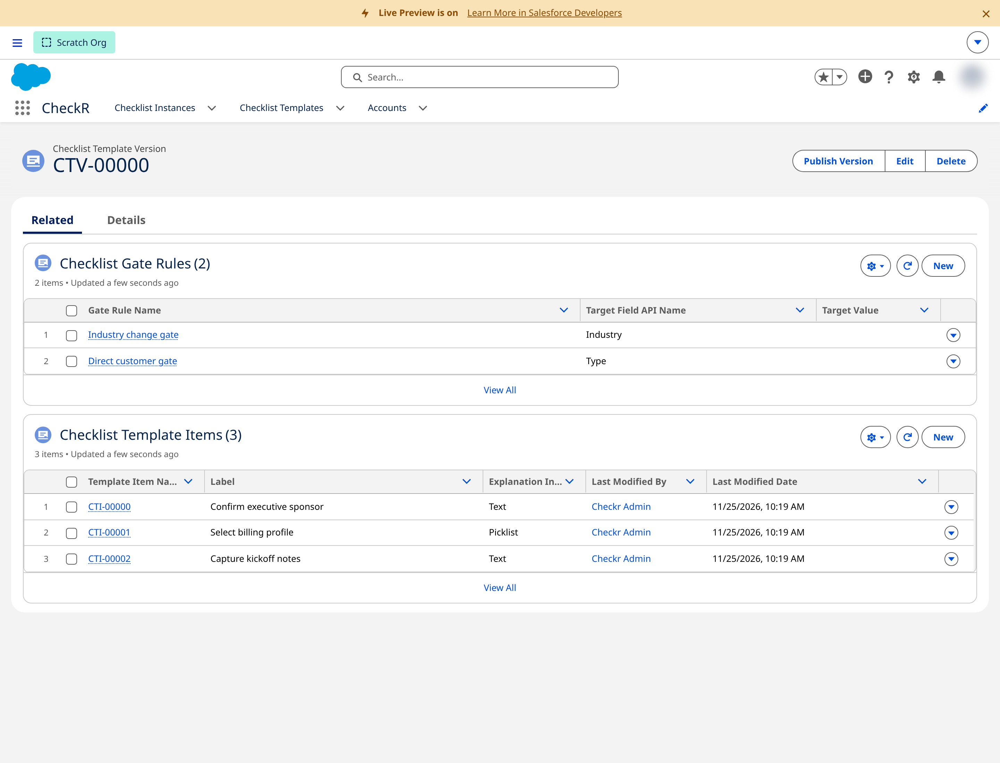
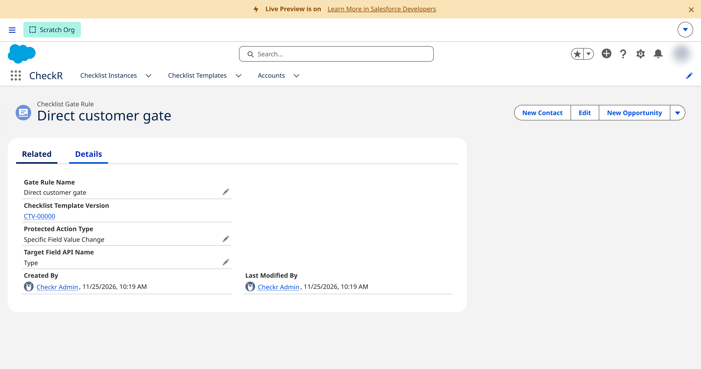

# Gate rules

A gate rule blocks a change to a field on the parent record while the record's
checklist is incomplete. Rules live on a template version, alongside its items,
and are frozen with the version when it publishes.

## Fields

From the Draft version's **Checklist Gate Rules** related list, select **New**.

| Field                 | Meaning                                                                                                                              |
| --------------------- | ------------------------------------------------------------------------------------------------------------------------------------ |
| Gate Rule Name        | A name admins recognize, for example "Industry change gate". It appears on bypass events.                                            |
| Target Field API Name | The parent-object field to watch, by API name, for example `Industry` or `StageName`. The target object is the template's object.    |
| Protected Action Type | `AnyFieldValueChange`: any change to the field. `SpecificFieldValueChange`: a change **to** one of the target values.                |
| Target Value          | One target value, for `SpecificFieldValueChange`.                                                                                    |
| Target Value Set      | Several target values, split on `;`, `,`, or a new line. Combined with Target Value.                                                 |
| Error Message         | The message the user sees when the rule blocks a save. Name the checklist and the field, so users and the runbook can find the rule. |
| Sort Order            | Evaluation order. The first blocking rule supplies the error.                                                                        |
| Active                | Inactive rules are ignored. On a Draft only; Published rules cannot be edited.                                                       |

Values compare as strings, exactly as Salesforce stores them: use the picklist
API value, not its label, and `true`/`false` for checkboxes. See
[platform constraints](../platform-constraints.md#gate-values-compare-as-strings).

## How a save is judged

On every update of a gated record, for each active rule on the object in sort
order:

1. If the watched field did not change, or for `SpecificFieldValueChange` did
   not change to a target value, the rule does not match.
2. If the record has a checklist from the rule's template:
   - and the checklist is from a **different version** than the rule, the rule
     is skipped (the record is judged by its own version);
   - and the checklist is **complete**, the rule passes;
   - otherwise the save is **blocked**.
3. If the record has no checklist from the template, the rule applies only if
   its version is **Published**; then the save is blocked.

The first blocking rule stops evaluation, and its error message is shown. A
checklist is complete when all its required template items are done.

## Examples

| Goal                                                                 | Field       | Action type                | Values                                                           |
| -------------------------------------------------------------------- | ----------- | -------------------------- | ---------------------------------------------------------------- |
| No Industry change until onboarding is done                          | `Industry`  | `AnyFieldValueChange`      |                                                                  |
| Don't make an Account a customer until onboarding is done            | `Type`      | `SpecificFieldValueChange` | `Customer - Direct` and `Customer - Channel` in Target Value Set |
| Don't close-win an Opportunity until the deal desk checklist is done | `StageName` | `SpecificFieldValueChange` | `Closed Won` in Target Value                                     |

## What is not gated

- **Inserts.** Creating a record never runs a gate, even with values a rule
  would block. A record has no Id yet, so it cannot have a
  checklist. Use a validation rule if inserts must be restricted. See
  [platform constraints](../platform-constraints.md#inserts-are-not-gated).
- **Objects without a trigger shim.** See [Enabling an object](03-enabling-an-object.md).
- **Draft versions**, for records with no checklist.
- **Changes away from a target value**, for `SpecificFieldValueChange`.
- **Users or integrations with bypass.** Their saves go through and are
  audited. See [Bypass](08-bypass.md).
