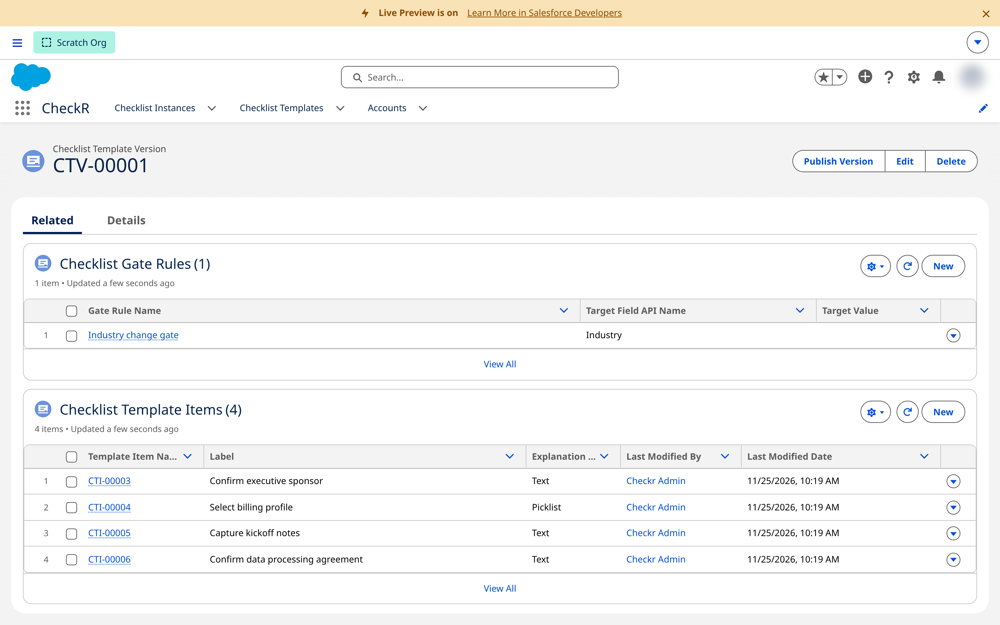
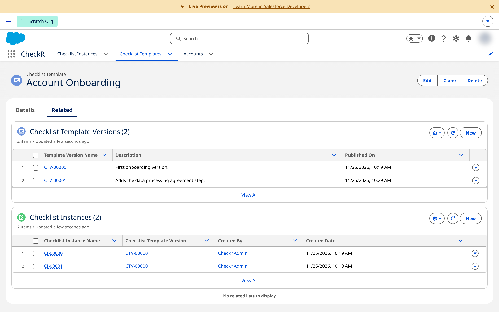

## Publish v1

1. Open the Draft version.
2. Check that it has at least one item and the gate rules you want.
3. Select **Publish Version**.

The version becomes **Published**, with publisher and timestamp recorded. Any
previous Published version becomes **Historical**, and the template's current
version pointer moves, all in one transaction. If anything fails, nothing
changes. You can now attach the checklist to records with **New Checklist**.

Published and Historical versions, their items, and their gate rules can no
longer be edited, and setting Status to Published or Historical by hand or
through the API is rejected. Publishing an empty or already published version is
also rejected. The action needs `CKR_Admin`. For a custom version record page,
add `CKR_ChecklistTemplateVersion__c.CKR_PublishVersion` to its actions.

## Make a change: publish v2

You never edit a published checklist. To change items or gate rules:

1. On the template, create a new Draft version with the next version number.
2. Recreate the items and gate rules it should have, with your changes.
3. Select **Publish Version** on it.

The template's versions list shows when each version was published; open a
version to see its Status (v1 is now Historical). Existing checklists still
point at v1.

## What happens to existing records

Publishing does not migrate existing checklists:

| The record has…            | After v2 publishes                                                                            |
| -------------------------- | --------------------------------------------------------------------------------------------- |
| A v1 checklist, complete   | Still complete. v1's rules are satisfied; v2's rules do not apply to it.                      |
| A v1 checklist, incomplete | Still judged by **v1's** rules, even though v1 is Historical. Completing it lifts v1's gates. |
| No checklist               | Judged by **v2's** rules. New checklists from **New Checklist** use v2.                       |

There is at most one checklist per record and template, so a record with a v1
checklist cannot also get a v2 one. If a record must move to v2, an admin with
`CKR_AuditMaintenance` deletes the old instance after exporting its history
(see [Audit history](09-audit-history.md)), then the user attaches a new one.

## Retire a template

Unchecking a template's **Active** box hides it from **New Checklist**. It does
not stop its gates: the Published version's rules still apply to records with
no checklist, and existing checklists are still judged by their own version's
rules.

To stop a template gating records, publish a new version with at least one item
and no gate rules, then uncheck Active. Records with no checklist are then not
gated by the template. A record with an incomplete checklist from an older
version is still judged by that version's rules until the checklist is completed
or, after an export, removed (see [Audit history](09-audit-history.md)).

The [template version publishing](../template-version-publishing.md) reference
and the [architecture notes](../architecture.md#template-version-lifecycle-and-gate-evaluation)
have the detail.
