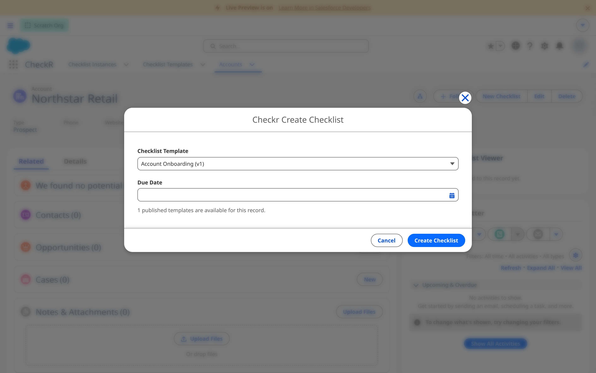
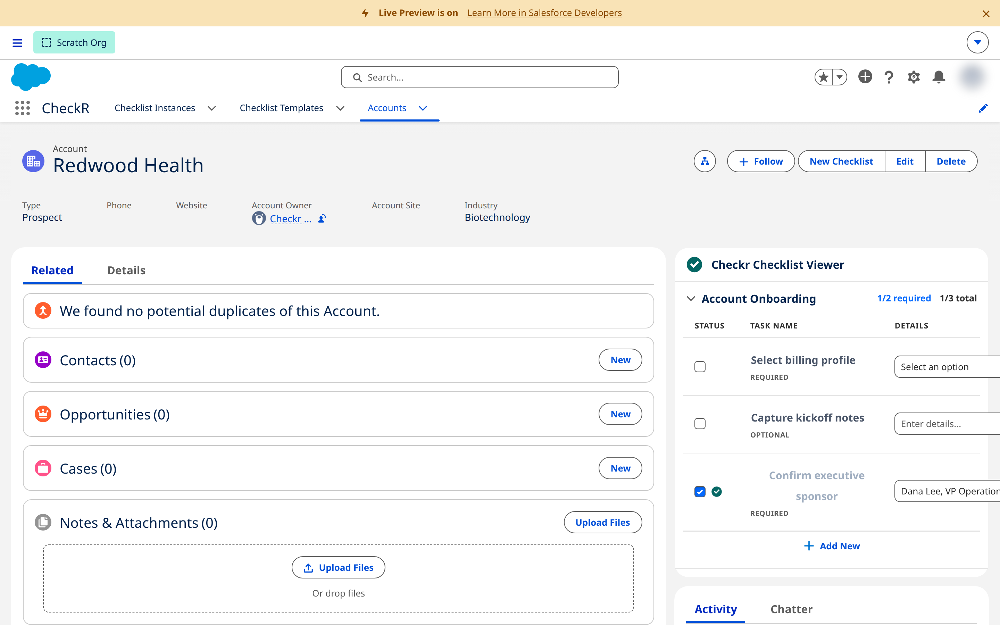
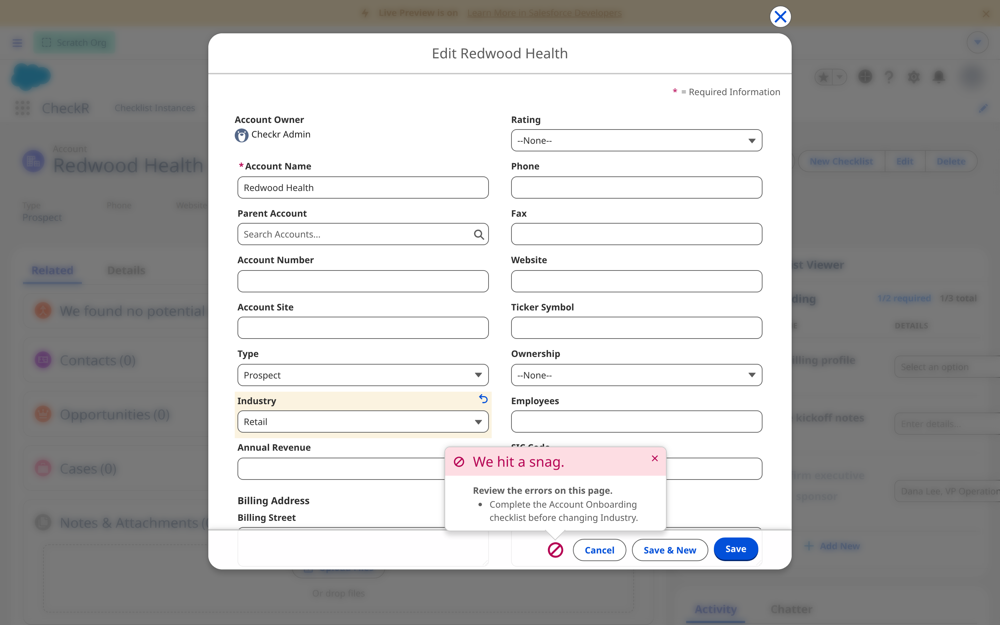

# Working a checklist

This chapter is the user's side, in brief, so you know what to tell them. Users
need `CKR_User` and access to the record.

## Attach a checklist

On a record without the checklist, select **New Checklist**, choose a Published
template, optionally set a due date, and select **Create Checklist**. The list
shows active templates for the object that have a Published version. A record
can have only one checklist per template.

## Complete items

The checklist viewer on the record page shows each checklist in an accordion,
with its progress. Users check items off; items that need an explanation ask
for one as text or from a picklist. Users can also add their own ad hoc items;
these never count toward completion. Every change is recorded in the audit
history.

Whether a user may complete items depends on the version's completion access
mode (see [Authoring a template](04-authoring-a-template.md#completion-access-mode)).

## When a save is blocked

If a user changes a gated field while the checklist is incomplete, the save
fails with the rule's error message:

Tell users to finish the checklist's required items and save again. If that is
not the right answer, follow the
[gate-blocking-saves runbook](../runbooks/gate-blocking-saves.md).
