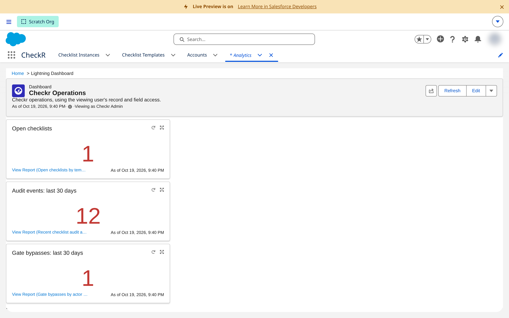
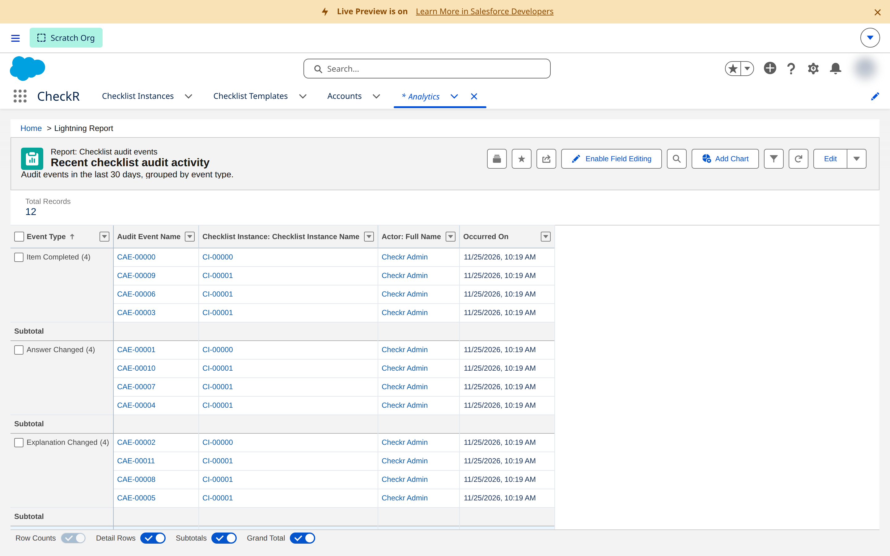
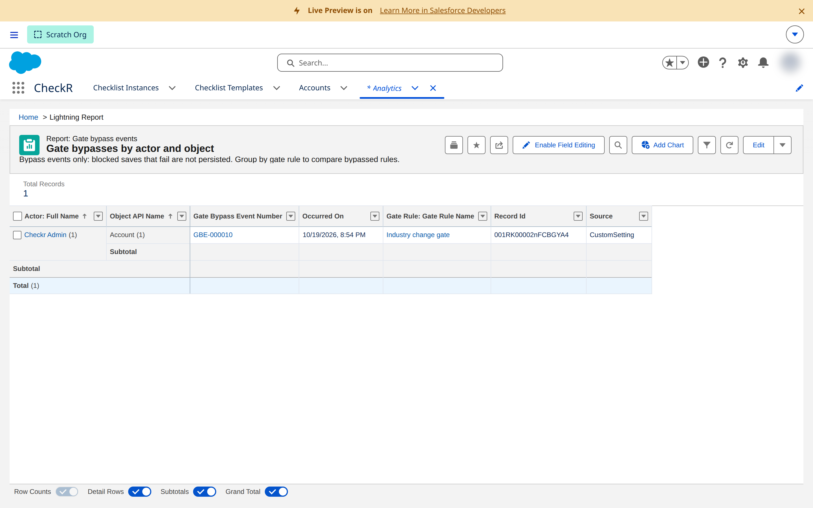

# Reports

## Operational reporting

CheckR ships three reports and a dashboard in the **CheckR Operations** folder
(API name `CKR_Checkr_Operations`) under **Reports** and **Dashboards**. The
dashboard shows one metric per report; open a report for the detail.

| Report                              | Shows                                                                                                         |
| ----------------------------------- | ------------------------------------------------------------------------------------------------------------- |
| Open checklists by template and age | Incomplete instances, grouped by template and by age since creation (0–7, 8–30, 31+ days), with the due date. |
| Recent checklist audit activity     | Audit events from the last 30 days, grouped by event type, with actor, time, and checklist.                   |
| Gate bypasses by actor and object   | Bypass events from the last 30 days, grouped by actor and object, with gate rule, record ID, and source.      |

Counts are instances or events, not distinct users, objects, or rules. To change
a report, clone it into your own folder; the shipped folders are read-only.

## Who sees what

Everything runs as the viewer. The dashboard is a dynamic dashboard (running
user: the logged-in user), so sharing, object permissions, and field
permissions decide what each person sees, and an empty result is valid when
nothing qualifies. Your edition must support dynamic dashboards; if it does
not, choose another dashboard setup before you deploy.

Both folders are public, so anyone with report access can find them, but a
folder grants no record access. `CKR_Admin`, `CKR_User`, and `CKR_ReadOnly`
grant the object and field access for the instance and audit reports. Of the
CheckR permission sets, only `CKR_Admin`, `CKR_GateBypass`, and
`CKR_AuditMaintenance` can read bypass events, so the bypass report is empty
for other users unless their profile grants access. No CheckR permission set
grants the
Salesforce **Run Reports** permission, and permission sets cannot be folder
share targets, so check profile reporting permissions and folder sharing when
you install.

## Building your own

The package adds four report types: **Checklist instances**, **Checklist
instances with optional items**, **Checklist audit events**, and **Gate bypass
events**. Count checklists with the instance-only type; the items type repeats
an instance once per item.

Limits to know:

- **Age Band** is a formula on the instance, calculated from the created date.
  It keeps aging after an instance is complete.
- Items have no due date, so there is no overdue-items report. The instance due
  date is in the open-checklists report.
- Blocked saves are not stored. The bypass report shows only bypasses, and each
  event names only the first rule that would have blocked. Group a clone by
  **Gate Rule** to compare rules; see [gate bypass operations](../gate-bypass.md).
- Audit and bypass events are append-only; see
  [records and retention](../records-and-retention.md).

The [reporting validation evidence](../evidence/2026-10-20-operational-reporting-7ce1408/README.md)
records a real-org deployment and run of all three reports and the dashboard.
