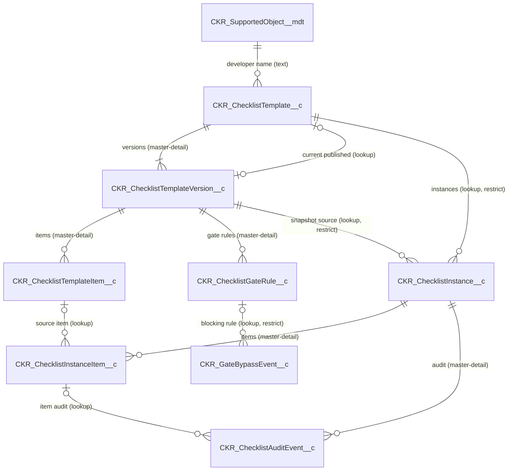

# Object model

This is an as-built reference for the CheckR schema in
`sfdx-source/checkr/main/schema`. It covers every `CKR_` custom object, the
`CKR_Settings__c` hierarchy custom setting, and the `CKR_SupportedObject__mdt`
custom metadata type. For access rules see [security](security.md); for the
Apex that reads and writes these objects see [architecture](architecture.md).

The no-org contract test `scripts/test/object-model.test.mjs` runs in `npm test`
through `npm run test:object-model`. It fails when a field in metadata is
missing from this page, when a documented field does not exist, or when a
documented type, required flag, or sharing model differs from the XML. Each
object section therefore has a `Sharing:` line and one field table whose first
column is the field API name.

**Required** means the field is required in metadata or is a master-detail
field, which Salesforce always requires. Standard fields (`Id`, `Name`,
`OwnerId`, audit fields) are not listed.

## Entity diagram

Relationships to the parent business record are text, not lookups:
`CKR_ChecklistInstance__c.CKR_ParentRecordId__c` and
`CKR_GateBypassEvent__c.CKR_RecordId__c` hold an 18-character Id so that any
supported object can be a parent without a lookup per object. The template's
link to `CKR_SupportedObject__mdt` is the developer name in
`CKR_SupportedObjectDeveloperName__c`. User lookups (`CKR_Actor__c`,
`CKR_AssigneeUser__c`, `CKR_CompletedBy__c`, `CKR_PublishedBy__c`) all clear on
user deletion (`SetNull`) and are omitted from the diagram.

## Template side

### `CKR_ChecklistTemplate__c`

Long-lived checklist template identity for one supported parent object. It
owns its versions and points at the current Published one. Templates are soft
retired with `CKR_Active__c` rather than deleted; deleting a template cascades
to its versions, items, and gate rules, and is blocked while instances or
bypass history reference them.

Sharing: `ReadWrite` (external `Private`). See the
[rationale](security.md#org-wide-defaults).

| Field                                 | Type         | Required | Meaning                                                                                                   |
| ------------------------------------- | ------------ | -------- | --------------------------------------------------------------------------------------------------------- |
| `CKR_Active__c`                       | Checkbox     | No       | Hides retired templates from New Checklist without deleting them. Does not stop gating. Defaults to true. |
| `CKR_CurrentPublishedVersion__c`      | Lookup       | No       | Pointer to the current Published version, maintained by the publish service. Clears on delete.            |
| `CKR_Description__c`                  | LongTextArea | No       | Business description of the template.                                                                     |
| `CKR_DeveloperName__c`                | Text         | Yes      | Stable admin-facing developer name (80).                                                                  |
| `CKR_SupportedObjectDeveloperName__c` | Text         | Yes      | Developer name of the `CKR_SupportedObject__mdt` record this template targets.                            |
| `CKR_TargetObjectApiName__c`          | Text         | Yes      | Parent object API name copied from the supported-object registry, for example `Account`.                  |

### `CKR_ChecklistTemplateVersion__c`

Draft, Published, or Historical snapshot of a template. Only the publish
service (`CKR_IChecklistTemplateVersionService.publish`) moves a version out
of Draft; Published and Historical versions, and their items and gate rules,
are immutable. See [template version publishing](template-version-publishing.md).

Sharing: `ControlledByParent` (parent: `CKR_ChecklistTemplate__c`).

| Field                                  | Type         | Required | Meaning                                                                                           |
| -------------------------------------- | ------------ | -------- | ------------------------------------------------------------------------------------------------- |
| `CKR_ChecklistTemplate__c`             | MasterDetail | Yes      | Parent template.                                                                                  |
| `CKR_CompletionAccessMode__c`          | Picklist     | Yes      | Who may complete items: `ReadAccess`, `EditAccess` (on the parent record), or `CustomPermission`. |
| `CKR_CustomPermissionDeveloperName__c` | Text         | No       | Custom permission required when the access mode is `CustomPermission`.                            |
| `CKR_Description__c`                   | LongTextArea | No       | Version notes about purpose or changes.                                                           |
| `CKR_PublishedBy__c`                   | Lookup       | No       | User who published the version (`User`).                                                          |
| `CKR_PublishedOn__c`                   | DateTime     | No       | When the version was published.                                                                   |
| `CKR_Status__c`                        | Picklist     | Yes      | Lifecycle: `Draft`, `Published`, `Historical`.                                                    |
| `CKR_VersionNumber__c`                 | Number       | Yes      | Incrementing version number within the template.                                                  |

### `CKR_ChecklistTemplateItem__c`

Checklist item definition on a template version. Active items are copied onto
each new instance as instance items.

Sharing: `ControlledByParent` (parent: `CKR_ChecklistTemplateVersion__c`).

| Field                              | Type         | Required | Meaning                                                                     |
| ---------------------------------- | ------------ | -------- | --------------------------------------------------------------------------- |
| `CKR_Active__c`                    | Checkbox     | No       | Inactive draft items are not copied to instances. Defaults to true.         |
| `CKR_AssigneeUser__c`              | Lookup       | No       | Default assignee copied to the instance item (`User`).                      |
| `CKR_ChecklistTemplateVersion__c`  | MasterDetail | Yes      | Parent template version.                                                    |
| `CKR_ExplanationInputType__c`      | Picklist     | Yes      | Explanation input: `Text` or `Picklist`.                                    |
| `CKR_ExplanationPicklistValues__c` | LongTextArea | No       | Allowed explanation values when the input type is `Picklist`.               |
| `CKR_ExplanationRequired__c`       | Checkbox     | No       | Item is complete only with an explanation.                                  |
| `CKR_HelpText__c`                  | LongTextArea | No       | End-user guidance for the item.                                             |
| `CKR_Label__c`                     | Text         | Yes      | End-user label (255).                                                       |
| `CKR_Required__c`                  | Checkbox     | No       | Required items block checklist completion, and therefore gates, until done. |
| `CKR_SortOrder__c`                 | Number       | No       | Display order within the version.                                           |

### `CKR_ChecklistGateRule__c`

Hard-stop rule on a template version. When the rule matches a save of the
parent record and the governing checklist is incomplete, the save is blocked.
See [gate evaluation](architecture.md#template-version-lifecycle-and-gate-evaluation)
and [platform constraints](platform-constraints.md).

Sharing: `ControlledByParent` (parent: `CKR_ChecklistTemplateVersion__c`).

| Field                             | Type         | Required | Meaning                                                                              |
| --------------------------------- | ------------ | -------- | ------------------------------------------------------------------------------------ |
| `CKR_Active__c`                   | Checkbox     | No       | Inactive rules are ignored. Defaults to true.                                        |
| `CKR_ChecklistTemplateVersion__c` | MasterDetail | Yes      | Parent template version.                                                             |
| `CKR_ErrorMessage__c`             | LongTextArea | No       | User-facing error shown when the rule blocks a save.                                 |
| `CKR_ProtectedActionType__c`      | Picklist     | Yes      | `AnyFieldValueChange` or `SpecificFieldValueChange`.                                 |
| `CKR_SortOrder__c`                | Number       | No       | Evaluation order; the first blocking rule supplies the error.                        |
| `CKR_TargetFieldApiName__c`       | Text         | Yes      | API name of the parent-record field to watch.                                        |
| `CKR_TargetValueSet__c`           | LongTextArea | No       | Several target values for `SpecificFieldValueChange`, split on `;`, `,`, or newline. |
| `CKR_TargetValue__c`              | Text         | No       | Single target value for `SpecificFieldValueChange`.                                  |

## Instance side

### `CKR_ChecklistInstance__c`

A checklist attached to one business record, snapshotting a template version.
There is at most one instance per parent record and template, enforced by
`CKR_UniqueKey__c`. Ownership is the standard `OwnerId`. Deleting an instance
with audit history is blocked unless the user holds `CKR_Audit_Maintenance`;
see [records and retention](records-and-retention.md).

Sharing: `ReadWrite` (external `Private`). See the
[rationale](security.md#org-wide-defaults).

| Field                               | Type     | Required | Meaning                                                                                                       |
| ----------------------------------- | -------- | -------- | ------------------------------------------------------------------------------------------------------------- |
| `CKR_AgeBand__c`                    | Text     | No       | Formula: calendar-day age band since creation, for operational reports.                                       |
| `CKR_ChecklistTemplateVersion__c`   | Lookup   | Yes      | Template version this instance snapshots. Deletion of the version is restricted.                              |
| `CKR_ChecklistTemplate__c`          | Lookup   | Yes      | Template identity. Deletion of the template is restricted.                                                    |
| `CKR_CompletedRequiredItemCount__c` | Number   | No       | Maintained count of completed required template-derived items.                                                |
| `CKR_DueDate__c`                    | Date     | No       | Optional due date for reporting and overdue calculation.                                                      |
| `CKR_IsComplete__c`                 | Checkbox | No       | Derived: all required template-derived items are complete. Drives the gate; written in system mode.           |
| `CKR_IsOverdue__c`                  | Checkbox | No       | Derived: past due and still incomplete.                                                                       |
| `CKR_ParentObjectApiName__c`        | Text     | Yes      | API name of the parent record's object.                                                                       |
| `CKR_ParentRecordId__c`             | Text     | Yes      | 18-character Id of the parent record.                                                                         |
| `CKR_PercentComplete__c`            | Number   | No       | Derived percent complete for the UI and reports.                                                              |
| `CKR_RequiredItemCount__c`          | Number   | No       | Maintained count of required template-derived items.                                                          |
| `CKR_UniqueKey__c`                  | Text     | No       | Unique external Id `<parentRecordId>\|<templateId>`, set by the instance service. Blocks duplicate instances. |

### `CKR_ChecklistInstanceItem__c`

A checklist item on an instance: either a snapshot of a template item or an ad
hoc item added by a user. Items are always checkbox items. Completion fields are
read-only for `CKR_User` and written by the service in system mode.

Sharing: `ControlledByParent` (parent: `CKR_ChecklistInstance__c`).

| Field                              | Type         | Required | Meaning                                                                |
| ---------------------------------- | ------------ | -------- | ---------------------------------------------------------------------- |
| `CKR_AssigneeUser__c`              | Lookup       | No       | User assigned to work the item (`User`). Item assignment is user-only. |
| `CKR_CheckboxValue__c`             | Checkbox     | No       | Raw checkbox value.                                                    |
| `CKR_ChecklistInstance__c`         | MasterDetail | Yes      | Parent instance.                                                       |
| `CKR_ChecklistTemplateItem__c`     | Lookup       | No       | Source template item. Blank for ad hoc items.                          |
| `CKR_CompletedBy__c`               | Lookup       | No       | Last user who completed the item (`User`).                             |
| `CKR_CompletedOn__c`               | DateTime     | No       | When the item was last completed.                                      |
| `CKR_Completed__c`                 | Checkbox     | No       | Derived completion state (checkbox plus any required explanation).     |
| `CKR_ExplanationInputType__c`      | Picklist     | Yes      | Explanation input: `Text` or `Picklist`.                               |
| `CKR_ExplanationPicklistValues__c` | LongTextArea | No       | Snapshot of allowed explanation values.                                |
| `CKR_ExplanationRequired__c`       | Checkbox     | No       | Item is complete only with an explanation.                             |
| `CKR_Explanation__c`               | LongTextArea | No       | Explanation supplied by the user.                                      |
| `CKR_Label__c`                     | Text         | Yes      | Snapshot label, or the label of an ad hoc item.                        |
| `CKR_LockedFromTemplate__c`        | Checkbox     | No       | Prevents structural edits to template-derived items.                   |
| `CKR_Required__c`                  | Checkbox     | No       | Item is required for completion. Gate-driving; written in system mode. |
| `CKR_SortOrder__c`                 | Number       | No       | Display order within the instance.                                     |
| `CKR_SourceType__c`                | Picklist     | Yes      | `Template` or `AdHoc`.                                                 |

## Audit

Both audit objects are append-only: updates and deletes are rejected unless the
user holds `CKR_Audit_Maintenance`. See
[records and retention](records-and-retention.md).

### `CKR_ChecklistAuditEvent__c`

Operational audit log for checklist activity, written by the application in
system mode. Users cannot create audit events.

Sharing: `ControlledByParent` (parent: `CKR_ChecklistInstance__c`).

| Field                          | Type         | Required | Meaning                                                                                                                                |
| ------------------------------ | ------------ | -------- | -------------------------------------------------------------------------------------------------------------------------------------- |
| `CKR_Actor__c`                 | Lookup       | No       | User who caused the event (`User`).                                                                                                    |
| `CKR_ChecklistInstanceItem__c` | Lookup       | No       | Item the event concerns, when item-specific.                                                                                           |
| `CKR_ChecklistInstance__c`     | MasterDetail | Yes      | Parent instance.                                                                                                                       |
| `CKR_Details__c`               | LongTextArea | No       | Additional context.                                                                                                                    |
| `CKR_EventType__c`             | Picklist     | Yes      | `ItemCompleted`, `ItemUncompleted`, `AnswerChanged`, `ExplanationChanged`, `AssigneeChanged`, `AdHocItemAdded`, or `AdHocItemRemoved`. |
| `CKR_NewValue__c`              | LongTextArea | No       | New value summary.                                                                                                                     |
| `CKR_OccurredOn__c`            | DateTime     | No       | When the event occurred.                                                                                                               |
| `CKR_OldValue__c`              | LongTextArea | No       | Prior value summary.                                                                                                                   |

### `CKR_GateBypassEvent__c`

One row per save that a gate would have blocked but a bypass switch allowed.
Independent of checklist instances. Written in system mode by the gate service
in the same transaction as the save. See [gate bypass](gate-bypass.md).

Sharing: `Private` (external `Private`).

| Field                  | Type         | Required | Meaning                                                                                                          |
| ---------------------- | ------------ | -------- | ---------------------------------------------------------------------------------------------------------------- |
| `CKR_Actor__c`         | Lookup       | No       | User who saved the bypassed record (`User`).                                                                     |
| `CKR_Details__c`       | LongTextArea | No       | Gate error that would have blocked the save.                                                                     |
| `CKR_GateRule__c`      | Lookup       | No       | First rule that would have blocked. Restrict: the rule, version, and template cannot be deleted while it exists. |
| `CKR_ObjectApiName__c` | Text         | No       | API name of the bypassed parent object.                                                                          |
| `CKR_OccurredOn__c`    | DateTime     | No       | When the bypass happened.                                                                                        |
| `CKR_RecordId__c`      | Text         | No       | Parent record saved through the bypass.                                                                          |
| `CKR_Source__c`        | Picklist     | No       | `CustomPermission` or `CustomSetting`; the custom permission wins when both apply.                               |

## Configuration

### `CKR_Settings__c`

Hierarchy custom setting (org, profile, user). A more specific explicit false
overrides an inherited true.

Sharing: none (hierarchy custom setting).

| Field               | Type     | Required | Meaning                                                               |
| ------------------- | -------- | -------- | --------------------------------------------------------------------- |
| `CKR_BypassGate__c` | Checkbox | No       | Bypass gates for the effective scope. Every bypassed save is audited. |

### `CKR_SupportedObject__mdt`

Custom metadata registry of parent objects that CheckR supports. A template
targets one supported object. Gates fire only on objects that also have a
deployed trigger shim; see [platform constraints](platform-constraints.md#trigger-shim-per-object).

Sharing: none (custom metadata type).

| Field                      | Type     | Required | Meaning                                                                   |
| -------------------------- | -------- | -------- | ------------------------------------------------------------------------- |
| `CKR_Active__c`            | Checkbox | No       | Object is available in admin and runtime flows. Defaults to true.         |
| `CKR_Description__c`       | Text     | No       | Why or how the object is supported.                                       |
| `CKR_HandlerClassName__c`  | Text     | No       | Optional Apex handler or registry key for trigger-based gate enforcement. |
| `CKR_ObjectApiName__c`     | Text     | Yes      | Unique API name of the parent object, for example `Account`.              |
| `CKR_ObjectLabelPlural__c` | Text     | Yes      | Plural label.                                                             |
| `CKR_ObjectLabel__c`       | Text     | Yes      | Singular label.                                                           |
| `CKR_SupportsGates__c`     | Checkbox | No       | Object may participate in gate enforcement.                               |
