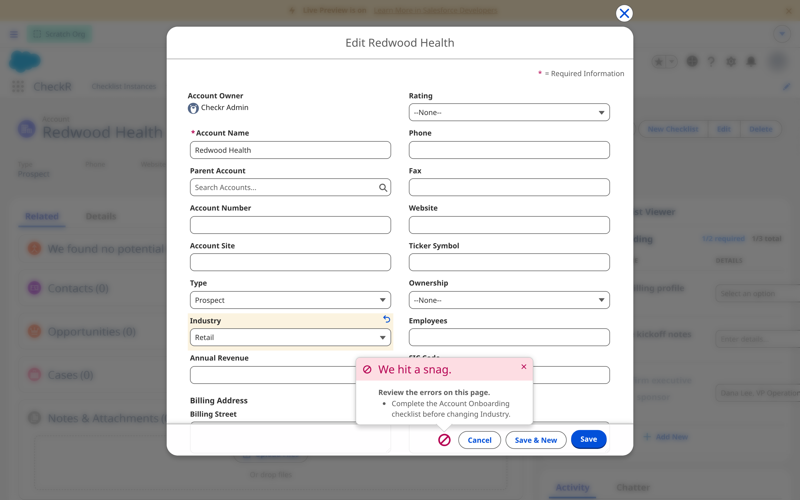

Use this runbook when users report that a record will not save and the error
comes from a CheckR gate. It gets you from the report to a fix: **Identify**
the rule, **Triage** the record's checklist, **Fix** in order of preference,
then **Confirm** and **Record**.

You need `CKR_Admin` and read access to the affected records. One fix needs
permission to assign permission sets.

## Checklist

- [ ] Identify: get the exact error text, the record, and the field changed.
- [ ] Identify: find the gate rule whose error message matches.
- [ ] Triage: does the record have a checklist from that template, which
      version, and is it complete?
- [ ] Fix: choose the first fix that applies (complete, new version, bypass,
      deactivate).
- [ ] Confirm: the user's save succeeds.
- [ ] Record: what happened, the fix, and any bypass events.

## Symptoms

The save fails with the gate rule's **Error Message**, shown on the record
like any validation error. Each rule's message is configured by an admin, for
example:

> Complete the Account Onboarding checklist before changing Industry.

A rule with no message shows this text, exactly:

> Checklist gate requirements are not satisfied.

Data loads and integrations see the same message as a
`FIELD_CUSTOM_VALIDATION_EXCEPTION` row error. Inserts are never blocked by a
gate, so if a **new** record fails, the cause is something else.



## 1. Identify the rule

Ask for the record, the field the user changed, the new value, and the
**exact** error text. Then find the rule. In the Developer Console or any SOQL
tool, as a `CKR_Admin` user:

```sql
SELECT Id, Name, CKR_TargetFieldApiName__c, CKR_ProtectedActionType__c,
       CKR_TargetValue__c, CKR_TargetValueSet__c, CKR_SortOrder__c,
       CKR_ErrorMessage__c, CKR_Active__c,
       CKR_ChecklistTemplateVersion__r.CKR_VersionNumber__c,
       CKR_ChecklistTemplateVersion__r.CKR_Status__c,
       CKR_ChecklistTemplateVersion__r.CKR_ChecklistTemplate__r.Name
FROM CKR_ChecklistGateRule__c
WHERE CKR_Active__c = TRUE
  AND CKR_ChecklistTemplateVersion__r.CKR_ChecklistTemplate__r.CKR_TargetObjectApiName__c = 'Account'
ORDER BY CKR_SortOrder__c
```

Replace `Account` with the record's object. Match the error text to
`CKR_ErrorMessage__c` and the changed field to `CKR_TargetFieldApiName__c`.
If several rules match the change, the **lowest sort order** blocked first;
only its message is shown, and the next one may block after you fix it. If the
message is the default text, use the field and values to find the rule, and
give it a specific message in its next version.

## 2. Triage the checklist

Find the record's checklist for that rule's template:

```sql
SELECT Id, Name, CKR_IsComplete__c, CKR_PercentComplete__c,
       CKR_RequiredItemCount__c, CKR_CompletedRequiredItemCount__c,
       CKR_ChecklistTemplateVersion__r.CKR_VersionNumber__c,
       CKR_ChecklistTemplateVersion__r.CKR_Status__c
FROM CKR_ChecklistInstance__c
WHERE CKR_ParentRecordId__c = '<18-character record Id>'
```

| What you find                                      | Meaning                                                                                            |
| -------------------------------------------------- | -------------------------------------------------------------------------------------------------- |
| A checklist, incomplete, same version as the rule  | Working as designed: required items are outstanding. Go to fix A.                                  |
| A checklist, complete                              | That rule cannot be blocking. Recheck step 1: another rule or template is blocking.                |
| A checklist from a different version than the rule | That rule does not apply to this record. Recheck step 1 for a rule on the checklist's own version. |
| No checklist, rule on the Published version        | Blocked until a checklist is attached and completed. Go to fix A.                                  |

The checklist viewer on the record shows the same thing, with the outstanding
items.

## 3. Fix, in order of preference

### A. Complete the checklist (preferred)

The user, or whoever owns the items, attaches the checklist with **New
Checklist** if there is none, completes the required items, and saves again.
This is the gate doing its job. If the user cannot check items off, see
[Troubleshooting](../admin-guide/11-troubleshooting.md#a-user-cannot-check-items-off).

### B. The rule is wrong: fix it in a new version

If the rule blocks changes it should not (wrong field, wrong values, too broad),
create a new Draft version without the mistake, and publish it. See
[Publishing and new versions](../admin-guide/06-publishing-and-new-versions.md).

This fixes records **without** a checklist straight away. Records that already
have a checklist from the old version are still judged by the old rules ;
for those, complete the checklist, or use fix C for an urgent save.

### C. Urgent save: temporary, audited bypass

When a specific save must go through now (an urgent correction, or a blocked
integration or data load):

1. Assign `CKR_GateBypass` to the user or integration user who must save.
2. They save the record or rerun the load.
3. Remove the assignment straight away.

Every bypassed save creates a Gate Bypass Event. Don't use `CKR_Settings__c` at
the organization level for this: it bypasses everyone. See
[Bypass](../admin-guide/08-bypass.md).

### D. Last resort: deactivate the rule

Published rules cannot be edited, so you cannot just uncheck **Active**. To
take a rule out quickly, publish a new version without it (fix B). For records
that still have a checklist from the old version, the old rule keeps applying;
use fix C for them, and record why.

## 4. Confirm the fix

- The user saves the same change, and it succeeds.
- For fix B, a record without a checklist saves the change too, and the
  template's Published version is the new one.
- For fix C, the bypass event exists and the assignment is gone:

```sql
SELECT CKR_Actor__r.Name, CKR_RecordId__c, CKR_GateRule__r.Name,
       CKR_Source__c, CKR_OccurredOn__c
FROM CKR_GateBypassEvent__c
ORDER BY CKR_OccurredOn__c DESC
LIMIT 20
```

## 5. Record

In the incident or change ticket, write down:

- the record, field, value, and exact error text;
- the rule, its version, and whether the record had a checklist;
- the fix used and why the earlier fixes did not apply;
- for bypass, who held it, from when to when, and the Gate Bypass Event Ids;
- for a new version, its version number and the follow-up for records still on
  the old version.

The **Gate bypasses by actor and object** report (see
[Reports](../admin-guide/10-reports.md)) shows bypasses for a later review.
